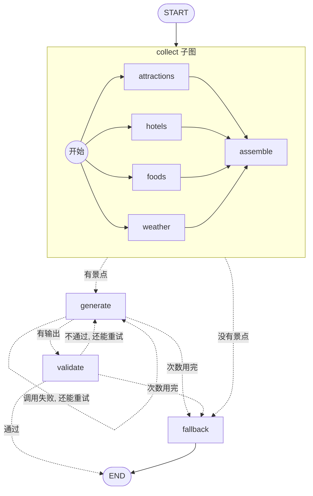

# P1：用 LangGraph 重写规划主流程

> **需求卡片**
> 产品后面要加"多轮修改行程""超预算时先问用户""刷新页面后继续"。现在的规划流程是一串 Python 函数调用，重试循环写在 `for` 里，这些能力都加不进去。
> 本迭代：**把主流程迁移到 LangGraph，对外接口行为保持不变**。

**目标**：把第 7 课的"生成 → 校验 → 重试 → 兜底"和第 9 课的"并行收集上下文"，改写成一张 LangGraph 状态图。学完你会真正理解 State、Reducer、条件边、子图、运行时依赖注入这 5 个概念，它们是后面 12 节课的地基。

## 为什么要换成图？

先看你现在的 [generation.py](../../backend/app/agents/generation.py) 里的核心循环：

```python
for attempt in range(1, MAX_ATTEMPTS + 1):
    ...
    try:
        response = llm.invoke(...)
        plan = parse_and_check(response, request)
        ...
    except Exception as exc:
        errors.append(...)
        continue
    return PlanResult(...)
return PlanResult(plan=build_fallback(...))
```

这段代码本身没有问题，但它有一个根本限制：**流程的"状态"全部藏在 Python 的局部变量里**（`attempt`、`errors`、`plan`）。这意味着：

| 想做的事 | 用 for 循环 | 用 LangGraph |
|---|---|---|
| 中途暂停，等用户确认后再继续（P6） | 做不到：函数一返回，局部变量就没了 | `interrupt()`，状态自动保存 |
| 服务重启后从中断处继续（P12） | 做不到 | checkpointer 按步保存状态 |
| 用户说"改一下第二天"（P5） | 只能整份重来 | 读出上一次的 state，只改一部分 |
| 看清楚每一步花了多久、输入输出是什么（P2） | 到处加 print | 每个节点自动成为 trace 里的一个 span |
| 给新同事讲清楚流程 | 读代码 | `draw_mermaid()` 直接画出流程图 |

前端类比：for 循环版像是把所有逻辑写在一个巨大的 `onClick` 里；LangGraph 版像是**状态机（XState）+ Redux**：状态集中存放，每一步只是"读状态 → 返回更新"，流程由图的边决定。

## 5 个核心概念

| 概念 | 一句话 | 前端类比 |
|---|---|---|
| **State** | 整张图共享的数据，节点读它、返回对它的更新 | Redux store |
| **Reducer** | 规定某个字段"怎么合并更新"，默认是覆盖 | Redux reducer |
| **Node** | 一个普通函数：`(state) -> 要更新的字段` | 一个 action handler |
| **Edge / 条件边** | 节点执行完去哪；条件边由一个函数根据 state 决定 | 路由守卫 `beforeEach` |
| **Runtime Context** | 每次调用时传入的依赖（LLM 客户端、高德客户端），不属于 state | `provide / inject` |

还有一个：**子图**，编译好的图可以当成另一张图的一个节点，相当于把一组组件封装成一个组件。

## 本课的图



和第 9 课 `ContextTripPlanner` 的对应关系：

| 第 9 课 | P1 |
|---|---|
| `PlannerContextBuilder.collect`（ThreadPoolExecutor） | `collect` 子图：4 个节点 fan-out 并行 + `assemble` 汇总 |
| `if not attraction_pois: return fallback` | 条件边 `route_after_collect` |
| `generate_plan_with_retries` 里的 `llm.invoke` | `generate` 节点 |
| `parse_and_check` + `postprocess` 闭包 | `validate` 节点 |
| `for attempt in range(...)` + `continue` | 条件边 `route_after_generate` / `route_after_validate` 指回 `generate` |
| `return PlanResult(plan=build_fallback(...))` | `fallback` 节点 |

## 本课新增 / 修改的文件

```
app/
├── graph/                  ← 新增目录：以后所有 LangGraph 相关代码都放这里
│   ├── __init__.py
│   ├── state.py            ← State 和运行时依赖
│   ├── collect.py          ← collect 子图
│   └── trip_graph.py       ← 主图
├── agents/
│   ├── graph_planner.py    ← 新增：对外的规划器，接口和 ContextTripPlanner 一样
│   └── deps.py             ← 修改：增加 graph 模式
├── planner/context.py      ← 修改：工具方法改成公开的，抽出 assemble_context
└── config.py               ← 修改：planner_mode 增加 "graph"，并设为默认
```

```bash
cd backend
mkdir -p app/graph && touch app/graph/__init__.py
```

## Step 1：小重构 `app/planner/context.py`

collect 子图要单独调用每个工具，再自己汇总。所以要对第 9 课的代码做两处小改动：

**改动 1**：4 个 `_collect_xxx` 方法去掉开头的下划线，变成公开方法（Python 约定：下划线开头表示"内部用的，外面别调"）。`collect` 里 `jobs` 字典的引用也一起改：

```python
    def collect_attractions(self, request: TripRequest) -> dict[str, Any]:   # 原来是 _collect_attractions
    ...
    def collect_hotels(...)   # 同理
    def collect_foods(...)
    def collect_weather(...)
```

**改动 2**：把 `collect` 末尾"组装 context"的代码和开头"先放好空值"的代码各抽成一个函数，放在类的外面（`compact_for_prompt` 的上面）：

```python
    # ---------- 并行执行所有工具 ----------
    def collect(self, request: TripRequest) -> dict[str, Any]:
        jobs: dict[str, Callable[[TripRequest], dict[str, Any]]] = {
            "attractions": self.collect_attractions,
            "hotels": self.collect_hotels,
            "foods": self.collect_foods,
            "weather": self.collect_weather,
        }
        
        # 先放好空值：即使某个工具失败，context 的结构也是完整的（下游代码不用判断 key 是否存在）
        snapshot = empty_snapshot(request)

        tool_status: dict[str, dict[str, Any]] = {}
        # ……线程池部分不变……

        return assemble_context(request, snapshot, tool_status)


def empty_snapshot(request: TripRequest) -> dict[str, Any]:
    """所有工具都还没返回时的 snapshot：先放好空值，下游代码不用判断 key 是否存在"""
    return {
        "attraction_pois": [],
        "hotel_pois": [],
        "food_pois": [],
        "trip_weather": align_weather(request, []),
    }


def assemble_context(request: TripRequest, snapshot: dict[str, Any], tool_status: dict[str, Any]) -> dict[str, Any]:
    """把工具结果组装成完整的 PlannerContext（P1 从 collect 里抽出来，LangGraph 版也要用）"""
    party = request.party
    return {
        "version": "planner_context_v1",
        # ……和原来 collect 末尾 return 的字典完全一样……
    }
```

改完启动一次后端、生成一次行程，确认和改之前一样。**重构的节奏：每次只动一小步，动完马上验证。**

## Step 2：State 和依赖 `app/graph/state.py`

```python
"""图的"状态"和"依赖"：整张图里所有节点共享的数据结构"""

import operator
from dataclasses import dataclass
from typing import Annotated, Any, Literal, TypedDict

from langchain_core.language_models import BaseChatModel

from app.models.schemas import TripPlan, TripRequest
from app.services.amap_client import AmapClient


class TripState(TypedDict, total=False):
    request: TripRequest  # 输入：用户的旅行需求
    context: dict[str, Any]  # collect 子图产出的 PlannerContext
    draft: str  # 大模型最近一次的原始输出（还没校验）
    attempts: int  # 已经调用了几次大模型
    # Annotated[类型, reducer]：这个字段的更新方式不是"覆盖"，而是用 operator.add 把新旧值相加
    # 节点返回 {"errors": ["第 2 次的错误"]}，state 里的 errors 会变成 [旧错误..., "第 2 次的错误"]
    # 前端类比：Redux reducer 里的 [...state.errors, ...action.payload]
    errors: Annotated[list[str], operator.add]
    warnings: list[str]
    plan: TripPlan  # 校验通过（或兜底）的最终行程
    source: Literal["llm", "fallback"]


@dataclass
class PlannerDeps:
    """运行时依赖：每次调用图时传进来，节点通过 runtime.context 读取

    为什么不放进 state？state 是"数据"，会被 checkpointer 序列化保存（P5），
    而高德客户端、大模型客户端是"工具"，既不能也不应该被保存
    前端类比：React 的 Context / Vue 的 provide-inject，组件（节点）不用层层传参就能拿到
    """

    amap: AmapClient
    llm: BaseChatModel
```

**要点**

1. **`total=False`**：所有字段都可以缺省。图刚启动时 state 里只有 `request`，其他字段由节点陆续填进来，所以读取时要用 `state.get("attempts", 0)`，不能直接 `state["attempts"]`（除非你确定前面的节点已经写过了）。
2. **只有 `errors` 需要 reducer**：其他字段都是"后写的覆盖先写的"，正好是默认行为。`errors` 要累积每次失败的原因，所以用 `operator.add`（列表相加 = 拼接）。
3. **节点返回的是"更新"，不是"新 state"**：节点返回 `{"attempts": 2}`，state 里的其他字段保持不变。这和 React 的 `setState({...})` 一样，是浅合并。
4. **state 里只放可以序列化的数据**。`TripRequest`、`TripPlan` 是 Pydantic 模型，LangGraph 能序列化；`AmapClient`、`ChatOpenAI` 里面有网络连接，放不进去，所以放在 `PlannerDeps`。

## Step 3：collect 子图 `app/graph/collect.py`

```python
"""collect 子图：4 个工具节点并行调高德，再汇总成 PlannerContext

        ┌→ attractions ┐
        ├→ hotels      ┤
START ──┼→ foods       ┼→ assemble → END
        └→ weather     ┘

对比第 9 课的 ThreadPoolExecutor：并行、汇总、错误隔离都由 LangGraph 负责，
每个工具还会在 trace（P2）里单独显示成一个节点，耗时和报错一目了然
"""

from typing import Annotated, Any, Callable, TypedDict

from langgraph.graph import END, START, StateGraph
from langgraph.runtime import Runtime

from app.graph.state import PlannerDeps
from app.models.schemas import TripRequest
from app.planner.context import PlannerContextBuilder, assemble_context, empty_snapshot


def merge_dict(old: dict, new: dict) -> dict:
    """reducer：把新字典合并进旧字典。4 个并行节点各自返回一部分，最后拼成一个完整的字典"""
    return {**old, **new}


class CollectState(TypedDict, total=False):
    request: TripRequest
    # 4 个节点在同一步里同时写 snapshot：没有 reducer 的话 LangGraph 会直接报错
    # （InvalidUpdateError：同一步里有多个节点更新了同一个字段，它不知道该听谁的）
    snapshot: Annotated[dict[str, Any], merge_dict]
    tool_status: Annotated[dict[str, Any], merge_dict]
    context: dict[str, Any]


class CollectInput(TypedDict):
    request: TripRequest


class CollectOutput(TypedDict):
    context: dict[str, Any]


# 工具名 → PlannerContextBuilder 上的方法（第 9 课写好的，P1 只是把下划线去掉变成公开方法）
# PlannerContextBuilder.collect_hotels 是"未绑定方法"，调用时要手动传 self：func(builder, request)
TOOLS: dict[str, Callable[[PlannerContextBuilder, TripRequest], dict[str, Any]]] = {
    "attractions": PlannerContextBuilder.collect_attractions,
    "hotels": PlannerContextBuilder.collect_hotels,
    "foods": PlannerContextBuilder.collect_foods,
    "weather": PlannerContextBuilder.collect_weather,
}


def make_tool_node(name: str, func: Callable):
    """工厂函数：为每个工具生成一个节点函数（4 个节点逻辑一样，只是调的方法不同）"""

    # runtime: Runtime[PlannerDeps]：LangGraph 看到这个参数名和类型，会自动把运行时依赖注入进来
    def node(state: CollectState, runtime: Runtime[PlannerDeps]) -> dict[str, Any]:
        builder = PlannerContextBuilder(runtime.context.amap)
        try:
            result = func(builder, state["request"])
        except Exception as exc:
            # 和第 9 课一样：失败只记录在 tool_status 里，不影响其他工具
            print(f"⚠️  工具 {name} 失败: {exc}")
            return {"tool_status": {name: {"ok": False, "error": str(exc)}}}
        count = len(next(iter(result.values())))
        return {"snapshot": result, "tool_status": {name: {"ok": True, "count": count}}}

    return node


def assemble(state: CollectState) -> dict[str, Any]:
    """4 个工具都结束后执行（成功或失败都算结束）：组装成完整的 PlannerContext"""
    request = state["request"]
    # empty_snapshot 打底：失败的工具没有写 snapshot，对应字段保持空值
    snapshot = empty_snapshot(request) | state.get("snapshot", {})
    return {"context": assemble_context(request, snapshot, state.get("tool_status", {}))}


def build_collect_graph():
    # input_schema / output_schema：对外只暴露 request（入）和 context（出），
    # snapshot、tool_status 是子图内部的"私有状态"，不会泄漏到主图
    builder = StateGraph(
        CollectState,
        context_schema=PlannerDeps,
        input_schema=CollectInput,
        output_schema=CollectOutput,
    )
    for name, func in TOOLS.items():
        builder.add_node(name, make_tool_node(name, func))
        builder.add_edge(START, name)  # START 连出 4 条边 = 4 个节点在同一步并行执行（fan-out）
    builder.add_node("assemble", assemble)
    # 第一个参数是列表：等列表里的节点全部执行完，才执行 assemble（fan-in，相当于 Promise.all 之后）
    builder.add_edge(list(TOOLS), "assemble")
    builder.add_edge("assemble", END)
    return builder.compile()
```

**要点**

1. **fan-out / fan-in**：`START` 连出 4 条边，LangGraph 会在**同一步（superstep）**里并行执行这 4 个节点（同步调用时用线程池，异步调用时用 `asyncio.gather`）。`add_edge([...], "assemble")` 表示"等 4 个都结束了才往下走"。效果和第 9 课的 `ThreadPoolExecutor` 一样，但你不用自己管线程了。
2. **为什么必须有 reducer**：4 个并行节点在同一步里都更新了 `snapshot`。没有 reducer 时 LangGraph 会抛出 `InvalidUpdateError`，因为它不知道该保留谁的。有了 `merge_dict`，4 份结果会被依次合并。**这就是 reducer 存在的意义：处理"多个来源同时更新一个字段"**。你可以把 `snapshot` 的 `Annotated` 去掉，启动后端生成一次行程，亲眼看看这个报错。
3. **`input_schema` / `output_schema`**：子图对外的"接口"。主图的 state 里有 `request` 和 `context`，子图只会读 `request`、只会写回 `context`，内部的 `snapshot`、`tool_status` 不会污染主图。前端类比：组件的 props（输入）和 emit（输出），内部的 data 是私有的。
4. **为什么 `TOOLS` 存的是 `PlannerContextBuilder.collect_hotels`，而不是 `builder.collect_hotels`**：模块加载时还没有 `builder`（高德客户端要到运行时才从 `runtime.context` 里拿到），所以先存"未绑定方法"，运行时再 `func(builder, request)`，第一个参数就是 `self`。

## Step 4：主图 `app/graph/trip_graph.py`

```python
"""规划主图：把第 7、9 课的"收集 → 生成 → 校验 → 重试 / 兜底"画成一张状态图

START → collect ──有景点──→ generate ──有输出──→ validate ──通过──→ END
           │                  ↑   │                │
           │                  │   └──调用失败──┐   │ 不通过
           │                  └────还能重试────┴───┘
           │                                   │ 次数用完
           └──没有景点──────→ fallback ←────────┘ → END
"""

import json
from typing import Any, Literal

from langchain_core.messages import HumanMessage, SystemMessage
from langgraph.graph import END, START, StateGraph
from langgraph.runtime import Runtime

from app.agents.generation import BASE_TEMPERATURE, MAX_ATTEMPTS, build_fallback
from app.agents.output import parse_and_check, recompute_budget
from app.agents.prompts import PLANNER_SYSTEM_PROMPT, build_context_prompt
from app.graph.collect import build_collect_graph
from app.graph.state import PlannerDeps, TripState
from app.models.schemas import WeatherInfo
from app.planner.context import compact_for_prompt
from app.planner.grounding import ground_plan


def error_reason(exc: Exception) -> str:
    """异常 → 一行简短的原因（和第 7 课 generate_plan_with_retries 里的写法一样）"""
    return f"{type(exc).__name__}: {str(exc).splitlines()[0]}"


# ---------- 节点：每个节点接收 state，返回"要更新的字段" ----------

def generate(state: TripState, runtime: Runtime[PlannerDeps]) -> dict[str, Any]:
    """调用一次大模型，只负责拿到原始输出，不做校验"""
    attempt = state.get("attempts", 0) + 1
    context_json = json.dumps(compact_for_prompt(state["context"]), ensure_ascii=False, separators=(",", ":"))
    prompt = build_context_prompt(context_json, state["request"].travel_days)
    if errors := state.get("errors"):
        prompt += f"\n\n注意：上一次的输出不合格，原因是：{errors[-1]}。请修正后重新输出完整 JSON。"

    temperature = BASE_TEMPERATURE + 0.1 * (attempt - 1)
    try:
        draft = runtime.context.llm.invoke(
            [SystemMessage(PLANNER_SYSTEM_PROMPT), HumanMessage(prompt)], temperature=temperature
        ).text
    except Exception as exc:  # 超时、网络错误：记一次失败，draft 置空
        print(f"⚠️  第 {attempt}/{MAX_ATTEMPTS} 次调用失败: {error_reason(exc)}")
        return {"attempts": attempt, "draft": "", "errors": [error_reason(exc)]}
    return {"attempts": attempt, "draft": draft}


def validate(state: TripState) -> dict[str, Any]:
    """校验 + grounding + 天气覆盖 + 预算重算（原来 context_planner 里 postprocess 闭包做的事）"""
    request, context = state["request"], state["context"]
    try:
        plan = parse_and_check(state["draft"], request)
        stats = ground_plan(plan, context)
        plan.weather_info = [WeatherInfo(**w) for w in context["tool_snapshot"]["trip_weather"]]
        plan.budget = recompute_budget(plan, request)
    except Exception as exc:
        print(f"⚠️  第 {state['attempts']}/{MAX_ATTEMPTS} 次校验失败: {error_reason(exc)}")
        return {"errors": [error_reason(exc)]}

    print(f"📍 Grounding: 景点命中率 {stats['attraction_rate']:.0%}，未匹配 {stats['ungrounded']}")
    status = context["tool_status"]
    warnings = [f"{name} 数据获取失败" for name, s in status.items() if not s["ok"]]
    warnings += [f"{name} 不在高德候选中" for name in dict.fromkeys(stats["ungrounded"])]
    return {"plan": plan, "source": "llm", "warnings": warnings}


def fallback(state: TripState) -> dict[str, Any]:
    request = state["request"]
    if state.get("attempts", 0) == 0:  # 一次都没调用大模型，说明是景点数据缺失
        error = state["context"]["tool_status"].get("attractions", {}).get("error", "没有搜到景点")
        reason = f"景点数据获取失败: {error}"
        return {"plan": build_fallback(request, reason), "source": "fallback", "errors": [reason]}
    print("❌ 大模型多次生成失败，返回兜底方案")
    return {"plan": build_fallback(request, "大模型多次生成失败"), "source": "fallback"}


# ---------- 路由函数：读 state，返回下一个节点的名字 ----------
# 返回值类型写成 Literal：LangGraph 会据此知道"可能去哪些节点"，画图时能画出所有分支

def route_after_collect(state: TripState) -> Literal["generate", "fallback"]:
    # 景点是行程的核心：没有景点候选就不调用大模型（第 9 课的规则）
    return "generate" if state["context"]["tool_snapshot"]["attraction_pois"] else "fallback"


def retry_or_give_up(state: TripState) -> Literal["generate", "fallback"]:
    return "generate" if state["attempts"] < MAX_ATTEMPTS else "fallback"


def route_after_generate(state: TripState) -> Literal["validate", "generate", "fallback"]:
    return "validate" if state["draft"] else retry_or_give_up(state)


def route_after_validate(state: TripState) -> Literal["generate", "fallback", "__end__"]:
    # "__end__" 就是 END 常量的值；plan 存在说明校验通过
    return END if state.get("plan") else retry_or_give_up(state)


def build_trip_graph():
    builder = StateGraph(TripState, context_schema=PlannerDeps)
    # 编译好的子图可以直接当成一个节点：主图只看到它的输入（request）和输出（context）
    builder.add_node("collect", build_collect_graph())
    builder.add_node("generate", generate)
    builder.add_node("validate", validate)
    builder.add_node("fallback", fallback)

    builder.add_edge(START, "collect")
    # 条件边：执行完 collect 后，调用 route_after_collect，按返回值决定去哪
    # 相当于前端路由守卫：beforeEach((to) => hasData ? next() : next('/fallback'))
    builder.add_conditional_edges("collect", route_after_collect)
    builder.add_conditional_edges("generate", route_after_generate)
    builder.add_conditional_edges("validate", route_after_validate)
    builder.add_edge("fallback", END)
    return builder.compile()


# 图的结构是固定的，模块加载时编译一次，所有请求共用（依赖通过 context 每次传入）
trip_graph = build_trip_graph()
```

**要点**

1. **节点只做一件事**。原来 `generate_plan_with_retries` 里一个 `try` 包住了"调模型 + 解析 + 校验 + grounding"。现在拆成 `generate`（只管调模型）和 `validate`（只管检查），P2 接入 trace 后，你能清楚地看到一次失败是"模型超时"还是"输出不合格"。
2. **重试循环变成了边**。`route_after_validate` 返回 `"generate"`，图就回到 `generate` 节点，`attempts` 从 state 里读出来 +1。没有 `for`，没有 `continue`。
3. **路由函数的返回类型写 `Literal[...]`**。这不只是类型提示：LangGraph 会读取它来知道"这条条件边可能通向哪些节点"，`draw_mermaid()` 才能画出所有分支，编译时也能检查节点名有没有拼错。
4. **递归上限**：图里有环（`generate → validate → generate`），LangGraph 用 `recursion_limit` 限制最多执行多少步，超过就抛出 `GraphRecursionError`。注意：老版本默认是 25，你装的 langgraph 1.2 默认已经放宽到 1 万步左右，几乎等于不设防。所以**环的出口必须由你的路由函数保证**（这里是 `attempts < MAX_ATTEMPTS`），线上也建议调用时显式传 `config={"recursion_limit": 20}` 兜底。
5. **`trip_graph` 在模块加载时编译一次**。编译后的图是无状态的"蓝图"，可以被所有请求同时使用；每次请求的数据在 state 里，依赖在 context 里，互不干扰。这和"每个请求 new 一个 Agent"的写法相比，省掉了重复构建的开销。

## Step 5：对外的规划器 `app/agents/graph_planner.py`

```python
"""LangGraph 版规划器（P1）：对外接口和 ContextTripPlanner 完全一样，路由层不需要任何修改"""

from langchain_core.language_models import BaseChatModel

from app.agents.generation import PlanResult
from app.agents.progress import ProgressFn, no_progress
from app.graph.state import PlannerDeps, TripState
from app.graph.trip_graph import trip_graph
from app.models.schemas import TripRequest
from app.services.amap_client import AmapClient


def progress_of(node: str, update: dict) -> tuple[str, int] | None:
    """节点执行完 → 要上报的进度。返回 None 表示这一步不上报"""
    if node == "collect":
        return "数据收集完成，正在生成行程", 40
    if node == "generate":
        attempt = update["attempts"]
        return f"第 {attempt} 次生成完成，正在校验", 50 + 10 * attempt
    if node == "validate" and "plan" in update:
        return "校验通过", 90
    if node == "fallback":
        return "智能规划失败，使用基础行程", 90
    return None


class GraphTripPlanner:
    def __init__(self, amap: AmapClient, llm: BaseChatModel):
        self.deps = PlannerDeps(amap=amap, llm=llm)

    def plan(self, request: TripRequest, on_progress: ProgressFn = no_progress) -> PlanResult:
        on_progress("正在查询景点、酒店、餐厅和天气", 10)
        final: TripState = {}
        # stream_mode 传列表时，每次产出 (模式, 数据)：
        #   "updates"：某个节点刚执行完，数据是 {节点名: 这个节点返回的更新}，用来上报进度
        #   "values"：每一步执行完后的完整 state，最后一次就是最终结果
        for mode, chunk in trip_graph.stream({"request": request}, context=self.deps, stream_mode=["updates", "values"]):
            if mode == "values":
                final = chunk
                continue
            for node, update in chunk.items():
                if progress := progress_of(node, update or {}):
                    on_progress(*progress)
        on_progress("完成", 100)
        return PlanResult(
            plan=final["plan"],
            source=final["source"],
            attempts=final.get("attempts", 0),
            errors=final.get("errors", []),
            warnings=final.get("warnings", []),
        )
```

**要点**

1. **对外接口不变**：`GraphTripPlanner.plan(request, on_progress) -> PlanResult`，和 `ContextTripPlanner` 一模一样，所以 `trip.py` 路由、SSE 接口、前端一行都不用改。这就是基础课第 6 课用 `Protocol` 定义 `Planner` 的回报。
2. **`stream_mode=["updates", "values"]`**：`invoke` 只返回最终结果，`stream` 可以在执行过程中拿到每一步。我们用 `updates` 上报进度，用 `values` 拿最终 state。P4 会讲到第三种模式 `custom`，用来解决一个问题：现在只能在节点**执行完**之后上报进度，而最慢的 `generate` 节点在执行**过程中**什么也报不出来。
3. **`if progress := progress_of(...)`**：海象运算符，第 11 课讲过。

## Step 6：切换模式

`app/config.py`：

```python
    planner_mode: Literal["graph", "context", "direct", "multi_agent"] = "graph"
```

`app/agents/deps.py`，在 `mode = get_settings().planner_mode` 下面加：

```python
    if mode == "graph":
        from app.agents.graph_planner import GraphTripPlanner
        return GraphTripPlanner(amap=get_amap_client(), llm=llm)

```

如果你的 `.env` 里写了 `PLANNER_MODE=context`，改成 `graph` 或者删掉这一行。

## Step 7：看一看你的图

```bash
uv run python -c "from app.graph.trip_graph import trip_graph; print(trip_graph.get_graph(xray=True).draw_mermaid())"
```

把输出贴到 Obsidian 的 ` ```mermaid ` 代码块里（或者 https://mermaid.live ），就能看到图。`xray=True` 会把 collect 子图展开。实线是普通边，虚线是条件边。

然后用真实的 Key 启动后端，从前端生成一次行程，确认和以前的效果一样。

## 拓展：结构化输出 `with_structured_output`

LangChain 提供了一个"让模型直接返回 Pydantic 对象"的方法：

```python
structured_llm = llm.with_structured_output(TripPlan, method="function_calling")
plan: TripPlan = structured_llm.invoke(messages)   # 直接拿到 TripPlan，不用自己抠 JSON
```

原理：把 `TripPlan` 的 JSON Schema 作为一个"工具"的参数定义发给模型，模型通过 Function Calling 返回参数，LangChain 再用 Pydantic 解析。`method` 有三个选项：

| method | 原理 | 兼容性 |
|---|---|---|
| `"json_schema"`（ChatOpenAI 默认） | 接口的 `response_format={"type": "json_schema", ...}`，模型在解码层面被约束 | 最可靠，但很多 OpenAI 兼容接口不支持 |
| `"function_calling"` | 当成一次工具调用 | 支持 Function Calling 的模型都能用，国产模型首选 |
| `"json_mode"` | 只保证输出是合法 JSON，不保证结构 | 最宽松 |

**那为什么本课不用它？** 因为它只解决了第 7 课"安检门"的前两道（抠 JSON + 类型校验），解决不了后面几道：天数对不对、三餐齐不齐、景点是不是来自候选、价格有没有被改。这些**业务规则**永远需要你自己的 `validate` 节点。公司里常见的做法是两者结合：能用结构化输出就用（减少格式错误导致的重试），业务校验照做。作业 3 让你亲自试一试。

> 注意：`TripPlan` 里的 `Budget.total` 是 `computed_field`，`PartyInfo.total` 也是。生成 JSON Schema 时它们会被当成只读字段，不同模型对此的处理不一样。如果模型非要填 `total`，Pydantic 会忽略它，不影响结果。

## 常见报错

| 报错 | 原因 |
|---|---|
| `InvalidUpdateError: At key 'snapshot': Can receive only one value per step. Use an Annotated key to handle multiple values.` | 并行节点同时更新了一个没有 reducer 的字段 |
| `GraphRecursionError: Recursion limit of ... reached` | 图里的环没有出口，比如路由函数忘了判断 `attempts`（默认上限很大，可能要跑很久才报错，期间一直在调模型烧钱） |
| `KeyError: 'context'` | 节点读了一个前面还没有节点写过的字段，用 `state.get(...)` 或检查边的顺序 |
| `ValueError: Found edge ending at unknown node generat` | 路由函数返回的节点名拼错了 |
| 节点里拿到的 `runtime.context` 是 `None` | 调用图时忘了传 `context=PlannerDeps(...)` |

## 📝 课后作业

- [ ] 1. **亲手触发 reducer 报错**：把 `CollectState.snapshot` 的 `Annotated[..., merge_dict]` 改成普通的 `dict[str, Any]`，启动后端生成一次行程，读懂报错信息，再改回来。
- [ ] 2. **加一个节点**：在 `validate` 通过之后、`END` 之前加一个 `summarize` 节点，用代码（不调用大模型）生成一句话摘要写进 `plan.overall_suggestions` 的开头，例如"3 天 7 个景点，预计总花费 4200 元"。想一想：这个节点应该放在 `route_after_validate` 返回 `END` 的位置，路由函数要怎么改？
- [ ] 3. **试一试结构化输出**：写一个脚本，分别用 `with_structured_output(TripPlan, method="function_calling")` 和现在的方式，用你的真实模型各生成 3 次，记录：成功次数、耗时、业务校验（`validate_plan`）通过次数。把结果记在下面的笔记里。P3 学完评测之后，你会有更系统的方法做这种对比。
- [ ] 4. **思考题**：`generate` 节点调用大模型失败时，我们把 `draft` 设成 `""`，再由 `route_after_generate` 判断。另一种写法是让异常直接抛出去，用 LangGraph 的节点重试策略 `builder.add_node("generate", generate, retry_policy=RetryPolicy(max_attempts=3))`。两种写法各有什么优缺点？（提示：重试时还能不能把"上次错在哪"告诉模型？哪种错误适合哪种重试？）

## 我的笔记

<!-- 在这里记录你的答案和心得 -->
