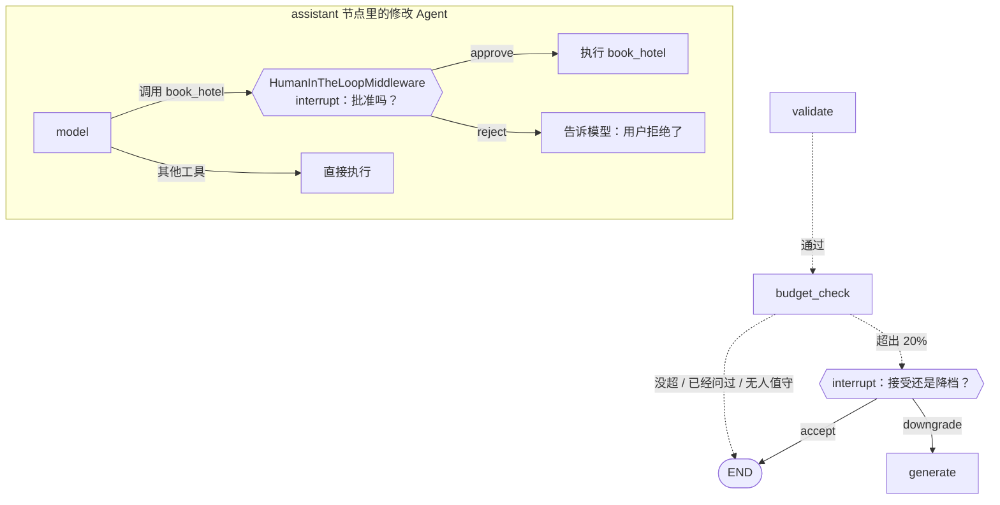

# P6：Human-in-the-loop（人工确认）

> **需求卡片**
> 业务要接入酒店预订（本迭代先用模拟接口）。法务的要求很明确：**任何涉及付款的操作，必须由用户明确确认后才能执行，Agent 不能自作主张**。
> 产品还提了一个需求：行程超出预算 20% 以上时，先问用户"加预算还是降档次"，而不是直接把超预算的方案丢给用户。
> 本迭代：**① 预订前暂停，等用户批准或拒绝；② 超预算时暂停，让用户做选择；③ 暂停期间刷新页面、隔一小时再回来，都能接着处理。**

**目标**：学会让 Agent 在关键节点"停下来问人"。学完你会掌握：LangGraph 的 `interrupt()` 和 `Command(resume=...)`、节点返回 `Command` 同时决定去向和更新 state、`HumanInTheLoopMiddleware` 给工具加审批、中断恢复时"节点重新执行"的语义、幂等设计、暂停状态下的接口设计。

> **特别验证过一点**：从暂停处恢复时，修改 Agent 是从它自己的检查点继续的，没有重新调用一次模型。

## 为什么需要"停下来问人"

Agent 的价值在于自主决策，但有些决策不应该由它做：

| 场景 | 为什么不能让 Agent 自己决定 |
|---|---|
| 付款、下单、发邮件、删除数据 | **不可逆**，做错了代价大 |
| 超预算、改日期 | 涉及**用户的偏好和取舍**，没有标准答案 |
| 信息不足（"带老人"但不知道能走多少路） | 猜错了整个方案都要返工 |

业界的说法是 **Human-in-the-loop（HITL）**：把人放进 Agent 的循环里，在关键节点由人把关。这是 Agent 产品上线时**法务、安全、风控最先问的问题**。

## 核心机制：interrupt 和 resume

```python
from langgraph.types import interrupt, Command

def some_node(state):
    answer = interrupt({"question": "超预算了，怎么办？"})   # ① 图在这里暂停
    ...                                                     # ③ 恢复后从这里继续，answer = "downgrade"
    
await graph.ainvoke(input, config)                          # 返回时 state 里带着 __interrupt__
await graph.ainvoke(Command(resume="downgrade"), config)    # ② 用户回答后，用 Command(resume=...) 恢复
```

前端类比：`interrupt()` 有点像 `await new Promise(resolve => showDialog(resolve))`，只不过等待的时间可以是几秒，也可以是几天，期间服务可以重启，因为 state 已经由 checkpointer 存进了数据库。

**最重要的一条规则：恢复时，节点会从头重新执行**。不是从 `interrupt()` 那一行接着往下走，而是整个节点函数重新调用一遍，执行到 `interrupt()` 时直接返回用户的回答。所以：

> **`interrupt()` 之前的代码必须可以安全地重复执行**。读 state、做计算没问题；如果在 `interrupt()` 之前调用了下单接口，恢复时就会再下一单。

## 本课的两种暂停



| | 预算确认 | 预订审批 |
|---|---|---|
| 在哪暂停 | 主图的 `budget_check` 节点，自己调用 `interrupt()` | 修改 Agent 里，由 `HumanInTheLoopMiddleware` 调用 `interrupt()` |
| 适用场景 | 流程里固定的检查点 | 某些**工具**执行前需要审批 |
| 用户的回答 | `"accept"` / `"downgrade"` | `{"decisions": [{"type": "approve"}]}` 等 |

## 本课新增 / 修改的文件

```
app/
├── services/booking.py      ← 新增：模拟的预订服务（带幂等）
├── graph/
│   ├── state.py             ← 修改：budget_confirmed；PlannerDeps 增加 booking、interactive
│   ├── trip_graph.py        ← 修改：budget_check 节点
│   └── edit_agent.py        ← 修改：book_hotel 工具 + HumanInTheLoopMiddleware
├── agents/
│   ├── generation.py        ← 修改：PlanResult 增加 pending
│   └── graph_planner.py     ← 重写：合并成 drive()，支持暂停和恢复
├── api/routes/trip.py       ← 修改：resume 接口；暂停时禁止发新消息
└── models/schemas.py        ← 修改：pending 字段、ResumeRequest
evals/run.py                 ← 修改：interactive=False
```

## Step 1：模拟预订服务 `app/services/booking.py`

```python
"""模拟的酒店预订服务（P6）

真实项目里这里会调用携程、飞猪等平台的接口，涉及真金白银。所以要演示两件事：
  1. 调用之前必须有用户明确的确认（HumanInTheLoopMiddleware）
  2. 幂等：同一个请求重复提交（用户双击、网络重试、Agent 重放），只下一单
"""

import uuid
from dataclasses import dataclass
from functools import lru_cache


@dataclass
class Order:
    order_id: str
    hotel: str
    check_in: str
    nights: int
    rooms: int
    total_price: int


class BookingService:
    def __init__(self) -> None:
        # 幂等键 → 订单。真实系统里这是数据库表上的一个唯一索引
        self.orders: dict[str, Order] = {}

    async def book_hotel(
        self, *, hotel: str, check_in: str, nights: int, rooms: int, unit_price: int, idempotency_key: str
    ) -> Order:
        # 幂等：这个键已经下过单了，直接返回原来的订单，不会重复扣款
        if idempotency_key in self.orders:
            return self.orders[idempotency_key]
        order = Order(
            order_id=f"HT{uuid.uuid4().hex[:10].upper()}",
            hotel=hotel, check_in=check_in, nights=nights, rooms=rooms,
            total_price=unit_price * nights * rooms,
        )
        self.orders[idempotency_key] = order
        return order


@lru_cache
def get_booking_service() -> BookingService:
    return BookingService()
```

**幂等（idempotency）**：同一个操作执行一次和执行多次，效果一样。支付、下单类接口**必须**幂等，因为重复提交在真实世界里无处不在：用户双击、网络超时后客户端自动重试、我们的 Agent 恢复时重放……做法是调用方生成一个"幂等键"，服务端记住"这个键已经处理过了"。真实的支付接口（微信支付的 `out_trade_no`、Stripe 的 `Idempotency-Key` 请求头）都是这个设计。

## Step 2：State 和依赖 `app/graph/state.py`

`TripState` 末尾加一个字段：

```python
    budget_confirmed: bool  # P6：用户已经就"超预算"做过选择了，不要再问第二次
```

`PlannerDeps` 加两个字段（导入改成 `from dataclasses import dataclass, field`，再导入 `BookingService, get_booking_service`）：

```python
@dataclass
class PlannerDeps:
    amap: AmapClient
    llm: BaseChatModel
    # P6：预订服务（模拟）。field(default_factory=...)：不传时调用这个函数创建默认值（dataclass 的写法）
    booking: BookingService = field(default_factory=get_booking_service)
    # P6：有没有人在线回答问题。评测、批处理时设成 False，遇到需要确认的情况按默认方式处理，不中断
    interactive: bool = True
```

**`interactive` 的意义**：同一张图会在不同场景下运行。用户在线时可以问；P3 的评测、将来的定时批量任务没有人能回答，如果照样 `interrupt()`，评测就会卡住（没有 checkpointer 时会直接返回一个带 `__interrupt__` 的结果，后面拿不到 `plan`）。把"能不能问人"作为运行时依赖传进去，图本身不用关心是谁在调用它。`evals/run.py` 里创建 `PlannerDeps` 时加上 `interactive=False`。

## Step 3：预算检查节点 `app/graph/trip_graph.py`

导入：

```python
from langgraph.types import Command, interrupt
```

在 `assistant` 节点上面加：

```python
# 超出预算多少比例时，暂停下来问用户
BUDGET_TOLERANCE = 0.2


def budget_check(state: TripState, runtime: Runtime[PlannerDeps]) -> Command[Literal["generate", "__end__"]]:
    """P6：行程超出预算 20% 以上时，暂停，问用户"接受"还是"降档重新规划"

    返回 Command：同时完成"更新 state"和"决定下一步去哪"，不需要再写一个路由函数
    Command[Literal[...]] 里列出可能去的节点，LangGraph 画图时才能画出这些边
    """
    constraint, plan = state["request"].budget_constraint, state["plan"]
    if constraint.amount is None or constraint.strictness == "none" or plan.budget is None:
        return Command(goto=END)
    total, amount = plan.budget.total, constraint.amount
    if total <= amount * (1 + BUDGET_TOLERANCE) or state.get("budget_confirmed") or not runtime.context.interactive:
        return Command(goto=END)

    # interrupt：暂停整张图，把这个字典交给调用方（最终到达前端）。state 已经由 checkpointer 保存好了
    # 用户回答后，调用方用 Command(resume="downgrade") 恢复，interrupt(...) 的返回值就是 "downgrade"
    # 注意：恢复时这个节点会从头重新执行一遍，所以 interrupt 之前的代码必须是"可以重复执行"的（这里只是读 state）
    choice = interrupt({
        "kind": "budget",
        "question": f"这份行程预计花费 {total} 元，超出你的预算 {amount} 元（{total / amount - 1:.0%}）",
        "total": total,
        "amount": amount,
        "options": {"accept": "接受这个方案", "downgrade": "降低档次，重新规划"},
    })
    if choice == "downgrade":
        # 回到 generate 重新生成：清掉旧行程、重置重试次数，把"要省钱"作为反馈告诉模型
        feedback = f"总花费 {total} 元超出了用户预算 {amount} 元。请改选更便宜的酒店和餐厅、减少收费景点，把总花费控制在预算以内"
        return Command(goto="generate", update={"plan": None, "attempts": 0, "budget_confirmed": True, "errors": [feedback]})
    return Command(goto=END, update={"budget_confirmed": True})
```

`route_after_validate` 改成通过后去 `budget_check`：

```python
def route_after_validate(state: TripState) -> Literal["generate", "fallback", "budget_check"]:
    # plan 存在说明校验通过。P6：通过之后先检查预算，而不是直接结束
    return "budget_check" if state.get("plan") else retry_or_give_up(state)
```

`build_trip_graph` 里注册节点：

```python
    builder.add_node("budget_check", budget_check)  # P6：它返回 Command 决定去向，不需要再 add_edge
```

**要点**

1. **降档 = 复用重试机制**。把"超预算了，请换便宜的"作为一条 `errors` 写进 state，`generate` 节点会自动把它拼进 prompt（P1 的逻辑），不需要为"降档"写任何新代码。好的设计会让新需求自然地落在已有的机制上。
2. **`budget_confirmed` 防止死循环**：降档后的方案如果还是超预算，不会再问第二次（否则用户会陷入"超了 → 降档 → 还是超了 → 降档……"）。
3. **为什么超预算的行程先给用户看？** `budget_check` 在 `validate` 之后，暂停时 state 里已经有完整的行程了。前端可以一边展示行程，一边弹窗问"超了 30%，要不要降档"，用户看着具体方案做决定，比对着一个数字做决定容易得多。

## Step 4：预订工具和审批中间件 `app/graph/edit_agent.py`

导入改两处：

```python
from langchain.agents.middleware import (
    HumanInTheLoopMiddleware, ModelRequest, SummarizationMiddleware, dynamic_prompt,
)
from langchain_core.messages import ToolCall, ToolMessage
```

在 `EDIT_TOOLS` 上面加工具和审批说明，并把工具加进列表：

```python
@tool
async def book_hotel(hotel_name: str, check_in: str, nights: int, rooms: int, runtime: Runtime) -> str:
    """预订酒店（P6）。hotel_name 必须是行程里安排的酒店；check_in 是入住日期 YYYY-MM-DD；nights 是连住几晚；rooms 是房间数。
    这是付费操作，系统会先请用户确认，用户同意后才会真正下单。"""
    try:
        row = find_row(runtime.state, "hotel", hotel_name)
    except EditError as exc:
        return f"预订失败：{exc}"
    order = await runtime.context.booking.book_hotel(
        hotel=row["name"], check_in=check_in, nights=nights, rooms=rooms,
        unit_price=row["estimated_cost_hint"],
        # 幂等键用 tool_call_id：同一次工具调用无论被执行几次（比如恢复时重放），都只会下一单
        idempotency_key=runtime.tool_call_id,
    )
    return f"预订成功，订单号 {order.order_id}，{order.hotel} {order.check_in} 入住 {order.nights} 晚 {order.rooms} 间，共 {order.total_price} 元"


def describe_booking(tool_call: ToolCall, state: dict, runtime) -> str:
    """审批弹窗里给用户看的说明：用人话把"要花多少钱、订什么"讲清楚，而不是丢给用户一串 JSON"""
    args = tool_call["args"]
    row = find_candidate(args.get("hotel_name", ""), state["context"]["tool_snapshot"]["hotel_pois"])
    price = row["estimated_cost_hint"] * args.get("nights", 0) * args.get("rooms", 0) if row else "未知"
    return f"即将预订 {args.get('hotel_name')}：{args.get('check_in')} 入住 {args.get('nights')} 晚，{args.get('rooms')} 间，预计 {price} 元"


EDIT_TOOLS = [
    list_candidates, replace_attraction, remove_attraction, add_attraction, replace_meal, update_day_description,
    book_hotel,
]
```

system prompt 的规则里加第 7 条：

```
7. 用户要求预订酒店时，按行程里的酒店和日期调用 book_hotel；房间数按同行人数计算（2 人一间）。用户拒绝预订时，不要再次尝试。
```

`build_edit_agent` 的 `middleware` 列表里，在 `edit_prompt` 后面加：

```python
            # P6：调用 book_hotel 之前暂停，等用户批准或拒绝。其他工具不受影响，照常自动执行
            # 原理：模型输出工具调用之后（after_model），中间件检查有没有要审批的工具，有就 interrupt()
            HumanInTheLoopMiddleware(
                interrupt_on={"book_hotel": {"allowed_decisions": ["approve", "reject"], "description": describe_booking}}
            ),
```

**要点**

1. **审批逻辑完全不在工具里**。`book_hotel` 本身不知道有审批这回事，它只管下单。审批由中间件在"模型决定调用工具之后、工具真正执行之前"插入。这样同一个工具在后台任务里（比如"用户已授权自动预订"）也能直接用，审批策略和业务逻辑分开。
2. **`allowed_decisions`** 一共有四种：`approve`（批准）、`edit`（用户修改参数后执行，比如把 2 间改成 1 间）、`reject`（拒绝，可附理由，理由会以工具结果的形式告诉模型）、`respond`（不执行工具，由人代替工具给出结果）。本课只开放前两种最常用的，`edit` 留作作业。
3. **`description` 可以是函数**，根据工具参数生成给用户看的说明。不要让用户对着 `{"hotel_name": "...", "nights": 1, "rooms": 2}` 做决定，要告诉他"即将预订 XX 酒店 1 晚 2 间，预计 600 元"。
4. **为什么 `book_hotel` 里还要检查酒店在不在候选里？** 用户批准的是"预订这家酒店"，但如果模型传的名字是编造的，批准了也订不到。审批不能代替参数校验。

## Step 5：暂停和恢复 `app/agents/graph_planner.py`（整个文件替换）

生成、对话、恢复三个场景的"运行图 + 转发事件"逻辑越来越像，合并成一个 `drive()` 函数：

```python
"""LangGraph 版规划器（P1 创建，P4 改成异步 + 事件流，P5 加上会话，P6 支持暂停 / 恢复）"""

from typing import Any, Callable

from langchain_core.messages import AIMessage, AIMessageChunk, HumanMessage, ToolMessage
from langgraph.graph.state import CompiledStateGraph
from langgraph.types import Command, Interrupt

from app.agents.generation import PlanResult
from app.graph.state import PlannerDeps
from app.graph.trip_graph import trip_graph
from app.models.schemas import TripRequest
from app.observability.tracing import langchain_callbacks

# 事件回调：每产生一个事件（进度、工具结果、一天的草稿……）就调用一次
EmitFn = Callable[[dict[str, Any]], None]


def no_emit(event: dict[str, Any]) -> None:
    """默认回调：什么都不做（和第 11 课的 no_progress 一样）"""


def thread_config(thread_id: str | None) -> dict[str, Any]:
    """P5：LangGraph 用 config["configurable"]["thread_id"] 区分会话。同一个 thread_id 的调用共享 state"""
    config: dict[str, Any] = {"callbacks": langchain_callbacks(), "run_name": "trip_graph", "recursion_limit": 30}
    if thread_id:
        config["configurable"] = {"thread_id": thread_id}
    return config


def describe_interrupt(item: Interrupt) -> dict[str, Any]:
    """P6：把 LangGraph 的 Interrupt 转成给前端的格式

    两种来源：
      budget_check 节点自己 interrupt 的：value 里有 kind="budget"
      HumanInTheLoopMiddleware 发起的：value 是 {"action_requests": [...], "review_configs": [...]}
    """
    value = item.value
    if isinstance(value, dict) and value.get("kind") == "budget":
        return {"id": item.id, **value}
    action = value["action_requests"][0]
    return {"id": item.id, "kind": "approval", "question": action.get("description", ""),
            "action": {"name": action["name"], "args": action["args"]}}


async def drive(
    graph: CompiledStateGraph, graph_input: Any, thread_id: str | None, deps: PlannerDeps, emit: EmitFn
) -> tuple[dict[str, Any], list[dict[str, Any]]]:
    """运行图（新的输入，或者 Command(resume=...)），把过程中的事件转发给 emit

    返回 (最终 state, 等待用户回答的问题列表)。问题列表不为空，说明图暂停了
    生成、对话、恢复三个场景都走这里（P6 从 plan_with_graph 和 chat_with_graph 里合并出来）
    """
    final: dict[str, Any] = {}
    async for namespace, mode, chunk in graph.astream(
        graph_input,
        config=thread_config(thread_id),
        context=deps,
        stream_mode=["custom", "messages", "values"],
        subgraphs=True,
    ):
        if mode == "custom":
            emit(chunk)
        elif mode == "messages":
            message, metadata = chunk
            if isinstance(message, ToolMessage):
                emit({"type": "tool_result", "name": message.name, "content": message.text})
            # 只推修改 Agent 的 model 节点的文字。generate 节点输出的是 JSON，P4 已经用逐天草稿的方式推送了
            elif isinstance(message, AIMessageChunk) and message.text and metadata.get("langgraph_node") == "model":
                emit({"type": "token", "text": message.text})
        elif namespace == ():
            final = chunk
    # 图暂停时，最后一次 values 里会带上 __interrupt__
    pending = [describe_interrupt(item) for item in final.get("__interrupt__", [])]
    for item in pending:
        emit({"type": "interrupt", **item})
    return final, pending


async def plan_with_graph(
    request: TripRequest,
    deps: PlannerDeps,
    emit: EmitFn = no_emit,
    graph: CompiledStateGraph = trip_graph,
    thread_id: str | None = None,
    user_id: str = "anonymous",
) -> PlanResult:
    emit({"type": "progress", "stage": "正在查询景点、酒店、餐厅和天气", "percent": 10})
    final, pending = await drive(graph, {"request": request, "user_id": user_id}, thread_id, deps, emit)
    emit({"type": "progress", "stage": "等待你的确认" if pending else "完成", "percent": 100})
    return result_of(final, pending)


def result_of(final: dict[str, Any], pending: list[dict[str, Any]]) -> PlanResult:
    return PlanResult(
        plan=final["plan"],
        source=final["source"],
        attempts=final.get("attempts", 0),
        errors=final.get("errors", []),
        warnings=final.get("warnings", []),
        pending=pending,
    )


def last_reply(final: dict[str, Any]) -> str:
    replies = [m for m in final.get("messages", []) if isinstance(m, AIMessage) and m.text and not m.tool_calls]
    return replies[-1].text if replies else ""


async def chat_with_graph(
    graph: CompiledStateGraph, thread_id: str, message: str, deps: PlannerDeps, emit: EmitFn = no_emit
) -> tuple[dict[str, Any], list[dict[str, Any]]]:
    """P5：在已有的会话上发一条消息。只传新消息，其他字段从 checkpointer 里读出上一次的 state"""
    return await drive(graph, {"messages": [HumanMessage(message)]}, thread_id, deps, emit)


async def resume_graph(
    graph: CompiledStateGraph, thread_id: str, interrupt_id: str, value: Any, deps: PlannerDeps, emit: EmitFn = no_emit
) -> tuple[dict[str, Any], list[dict[str, Any]]]:
    """P6：用户回答了问题，从暂停的地方继续
    Command(resume={中断 id: 回答})：指明回答的是哪一个中断（同时有多个中断时不会弄混）
    """
    return await drive(graph, Command(resume={interrupt_id: value}), thread_id, deps, emit)
```

**要点**

1. **`stream_mode` 三种一起用**：`custom`（P4 的逐天草稿、工具结果）、`messages`（P5 的打字机）、`values`（拿最终 state 和 `__interrupt__`）。降档重新生成时，`custom` 事件照样推送逐天草稿；预订审批通过后，`messages` 事件照样推送模型的回复，一个函数覆盖所有场景。
2. **按节点名过滤 `messages`**：`generate` 节点也调用了模型，它的 JSON 输出也会出现在 `messages` 流里。只转发 `langgraph_node == "model"` 的（修改 Agent 里调用模型的节点就叫 `model`）。
3. **`Command(resume={interrupt_id: value})`**：用字典指明回答的是哪一个中断。只有一个中断时直接 `Command(resume=value)` 也行，但带上 id 更稳妥，前端也必须告诉后端"我回答的是哪个问题"，过期的回答会被识别出来。

`app/agents/generation.py` 的 `PlanResult` 加一个字段：

```python
    pending: list[dict] = field(default_factory=list)  # P6：等待用户确认的问题（图暂停了）
```

## Step 6：数据模型 `app/models/schemas.py`

`TripPlanResponse` 和 `TripSession` 各加一个字段：

```python
    pending: list[dict] = Field(default_factory=list)  # P6：等待用户确认的问题；不为空时前端要弹窗
```

文件末尾追加：

```python
# ============================================================
# 人工确认（P6 新增）
# ============================================================
class ResumeRequest(BaseModel):
    interrupt_id: str = Field(..., description="要回答的是哪一个问题（来自 interrupt 事件的 id）")
    # budget 类问题：accept / downgrade；approval 类问题：approve / reject
    decision: Literal["accept", "downgrade", "approve", "reject"]
    message: str = Field(default="", max_length=200, description="拒绝时可以附上理由，会告诉模型")
```

## Step 7：路由 `app/api/routes/trip.py`（整个文件替换）

```python
"""旅行规划相关接口（P4：全部改成 async def；P5：会话、多轮修改、撤销）"""

import asyncio
import json
import logging
import uuid
from typing import Annotated, Any, AsyncIterator, Awaitable, Callable

from fastapi import APIRouter, Depends, Header, HTTPException, Request
from fastapi.responses import StreamingResponse
from langchain_core.messages import AIMessage, HumanMessage
from langgraph.graph.state import CompiledStateGraph
from langgraph.types import StateSnapshot

from app.agents.deps import get_planner_deps
from app.agents.graph_planner import (
    EmitFn, chat_with_graph, describe_interrupt, last_reply, no_emit, plan_with_graph, resume_graph, thread_config,
)
from app.agents.output import recompute_budget
from app.config import get_settings
from app.graph.state import PlannerDeps
from app.models.schemas import (
    ChatMessage, ChatRequest, FeedbackRequest, ResumeRequest, TripPlanResponse, TripRequest, TripSession,
)
from app.observability.tracing import score_trace, trace_span
from app.services.mock_planner import build_mock_plan

logger = logging.getLogger(__name__)

router = APIRouter(prefix="/trip", tags=["旅行规划"])

# P2：用户标识。现在还没有登录系统，前端生成一个匿名 ID 存在 localStorage 里，每次请求放在请求头上
# Annotated[str, Header(alias=...)]：从请求头 X-User-Id 读取，alias 指定请求头的名字
UserId = Annotated[str, Header(alias="X-User-Id", max_length=64)]

# 多久没有事件就发一次心跳（秒）
HEARTBEAT_SECONDS = 15


def get_graph(request: Request) -> CompiledStateGraph:
    """P5：带 checkpointer 的图在启动时编译好，挂在 app.state 上（见 main.py 的 lifespan）"""
    return request.app.state.trip_graph


Graph = Annotated[CompiledStateGraph, Depends(get_graph)]
Deps = Annotated[PlannerDeps | None, Depends(get_planner_deps)]


@router.get("/health", summary="旅行规划健康检查")
def trip_health():
    settings = get_settings()
    return {
        "status": "healthy",
        "service": "trip-planner",
        "amap_configured": bool(settings.amap_api_key),
        "llm_configured": bool(settings.llm_api_key),
        "tracing_configured": bool(settings.langfuse_public_key),
    }


# ---------- SSE 的公共部分（P5 从 P4 的 plan_trip_stream 里抽出来，生成和修改两个接口共用）----------

def sse(event: dict) -> str:
    return f"data: {json.dumps(event, ensure_ascii=False)}\n\n"


def sse_response(job: Callable[[EmitFn], Awaitable[dict[str, Any]]]) -> StreamingResponse:
    """job：一个异步函数，执行过程中通过 emit 发事件，最后返回"结果事件"

    和 P4 一样：后台任务 + 队列 + 心跳 + 客户端断开时取消
    """
    events: asyncio.Queue[dict | None] = asyncio.Queue()

    async def worker() -> None:
        try:
            events.put_nowait(await job(events.put_nowait))
        except HTTPException as exc:
            events.put_nowait({"type": "error", "message": exc.detail})
        except Exception as exc:
            logger.exception("任务失败")
            events.put_nowait({"type": "error", "message": str(exc)})
        finally:
            events.put_nowait(None)

    task = asyncio.create_task(worker())

    async def stream() -> AsyncIterator[str]:
        try:
            while True:
                try:
                    event = await asyncio.wait_for(events.get(), timeout=HEARTBEAT_SECONDS)
                except TimeoutError:
                    yield ": ping\n\n"
                    continue
                if event is None:
                    break
                yield sse(event)
        finally:
            if not task.done():
                task.cancel()
                logger.info("客户端已断开，取消任务")

    return StreamingResponse(
        stream(), media_type="text/event-stream", headers={"Cache-Control": "no-cache", "X-Accel-Buffering": "no"}
    )


# ---------- 生成行程 ----------

async def run_planner(
    request: TripRequest, deps: PlannerDeps | None, graph: CompiledStateGraph,
    user_id: str = "anonymous", emit: EmitFn = no_emit,
) -> TripPlanResponse:
    """普通接口和流式接口共用的核心逻辑"""
    if deps is None:
        plan = build_mock_plan(request)
        plan.budget = recompute_budget(plan, request)
        emit({"type": "progress", "stage": "完成", "percent": 100})
        return TripPlanResponse(success=True, message="未配置大模型，返回 mock 数据", data=plan)

    # P5：每次生成都开一个新会话。uuid4 是随机生成的，别人猜不到
    thread_id = uuid.uuid4().hex
    emit({"type": "thread", "thread_id": thread_id})
    with trace_span("trip_plan", user_id=user_id, session_id=thread_id, tags=["graph"],
                    input=request.model_dump(mode="json")) as span:
        result = await plan_with_graph(request, deps, emit, graph=graph, thread_id=thread_id, user_id=user_id)
        if span is not None:
            span.update(
                output={"source": result.source, "attempts": result.attempts,
                        "errors": result.errors, "warnings": result.warnings},
                level="WARNING" if result.source == "fallback" else "DEFAULT",
            )
        trace_id = span.trace_id if span is not None else None

    if result.source == "fallback":
        reason = result.errors[-1] if result.errors else "未知原因"
        message = f"智能规划失败，返回基础行程。原因：{reason}"
    else:
        message = f"旅行计划生成成功（第 {result.attempts} 次生成）"
    if result.warnings:
        message += "；注意：" + "；".join(result.warnings[:3])
    if result.pending:
        message = "行程已生成，有问题需要你确认"
    return TripPlanResponse(success=True, message=message, data=result.plan, trace_id=trace_id,
                            thread_id=thread_id, pending=result.pending)


@router.post("/plan", response_model=TripPlanResponse, summary="生成旅行计划")
async def plan_trip(request: TripRequest, deps: Deps, graph: Graph, user_id: UserId = "anonymous"):
    return await run_planner(request, deps, graph, user_id)


@router.post("/plan/stream", summary="生成旅行计划（SSE 推送进度和逐天草稿）")
async def plan_trip_stream(request: TripRequest, deps: Deps, graph: Graph, user_id: UserId = "anonymous"):
    async def job(emit: EmitFn) -> dict[str, Any]:
        response = await run_planner(request, deps, graph, user_id, emit)
        return {"type": "result", "data": response.model_dump(mode="json")}

    return sse_response(job)


# ---------- P5：会话 ----------

async def load_session(graph: CompiledStateGraph, thread_id: str, user_id: str) -> StateSnapshot:
    """读出会话的最新 state，并检查它是不是这个用户的

    不存在和"不是你的"都返回 404，而不是 403：不告诉别人"这个 thread_id 存在"，减少信息泄露
    """
    snapshot = await graph.aget_state(thread_config(thread_id))
    if not snapshot.values.get("plan") or snapshot.values.get("user_id") != user_id:
        raise HTTPException(status_code=404, detail="会话不存在")
    return snapshot


def to_chat_messages(messages: list) -> list[ChatMessage]:
    """只返回用户和助手说的话；工具调用、工具结果是内部过程，不展示"""
    result = []
    for m in messages:
        if isinstance(m, HumanMessage):
            result.append(ChatMessage(role="user", content=m.text))
        elif isinstance(m, AIMessage) and m.text and not m.tool_calls:
            result.append(ChatMessage(role="assistant", content=m.text))
    return result


def to_session(thread_id: str, snapshot: StateSnapshot) -> TripSession:
    values = snapshot.values
    return TripSession(
        thread_id=thread_id,
        plan=values["plan"],
        messages=to_chat_messages(values.get("messages", [])),
        pending=[describe_interrupt(item) for item in snapshot.interrupts],  # P6
    )


@router.get("/{thread_id}", response_model=TripSession, summary="获取会话（刷新页面后恢复）")
async def get_session(thread_id: str, graph: Graph, user_id: UserId = "anonymous"):
    return to_session(thread_id, await load_session(graph, thread_id, user_id))


def done_event(final: dict[str, Any], pending: list[dict[str, Any]]) -> dict[str, Any]:
    """对话、恢复两个接口的最后一个事件"""
    plan = final.get("plan")
    return {"type": "done", "reply": last_reply(final), "plan": plan.model_dump(mode="json") if plan else None,
            "pending": pending}


@router.post("/{thread_id}/chat", summary="用自然语言修改行程（SSE）")
async def chat(thread_id: str, body: ChatRequest, deps: Deps, graph: Graph, user_id: UserId = "anonymous"):
    if deps is None:
        raise HTTPException(status_code=503, detail="未配置大模型，无法修改行程")
    snapshot = await load_session(graph, thread_id, user_id)  # 先检查权限，不通过直接返回 404，不会开始 SSE
    if snapshot.interrupts:
        # P6：还有问题没回答（比如预订在等确认），这时候插进来一条新消息，暂停的那一步就永远接不上了
        raise HTTPException(status_code=409, detail="还有等待你确认的操作，请先处理")

    async def job(emit: EmitFn) -> dict[str, Any]:
        with trace_span("trip_chat", user_id=user_id, session_id=thread_id, input=body.message) as span:
            final, pending = await chat_with_graph(graph, thread_id, body.message, deps, emit)
            if span is not None:
                span.update(output=last_reply(final))
        return done_event(final, pending)

    return sse_response(job)


# 用户的选择 → 恢复图时传给 interrupt() 的值
# budget_check 节点期待的是字符串；HumanInTheLoopMiddleware 期待的是 {"decisions": [...]}
def resume_value(kind: str, body: ResumeRequest) -> Any:
    if kind == "budget" and body.decision in ("accept", "downgrade"):
        return body.decision
    if kind == "approval" and body.decision == "approve":
        return {"decisions": [{"type": "approve"}]}
    if kind == "approval" and body.decision == "reject":
        return {"decisions": [{"type": "reject", "message": body.message or "用户拒绝了这次操作"}]}
    raise HTTPException(status_code=422, detail=f"问题类型 {kind} 不接受 {body.decision}")


@router.post("/{thread_id}/resume", summary="回答等待确认的问题，从暂停处继续（SSE）")
async def resume(thread_id: str, body: ResumeRequest, deps: Deps, graph: Graph, user_id: UserId = "anonymous"):
    if deps is None:
        raise HTTPException(status_code=503, detail="未配置大模型")
    snapshot = await load_session(graph, thread_id, user_id)
    pending = {item["id"]: item for item in (describe_interrupt(i) for i in snapshot.interrupts)}
    if body.interrupt_id not in pending:
        # 409 Conflict：问题已经被回答过了（用户双击、两个标签页同时点）。这是幂等的第一道防线
        raise HTTPException(status_code=409, detail="这个问题已经处理过了，或者不存在")
    value = resume_value(pending[body.interrupt_id]["kind"], body)

    async def job(emit: EmitFn) -> dict[str, Any]:
        with trace_span("trip_resume", user_id=user_id, session_id=thread_id, input=body.model_dump()):
            final, new_pending = await resume_graph(graph, thread_id, body.interrupt_id, value, deps, emit)
        return done_event(final, new_pending)

    return sse_response(job)


@router.post("/{thread_id}/undo", response_model=TripSession, summary="撤销上一次修改")
async def undo(thread_id: str, graph: Graph, user_id: UserId = "anonymous"):
    """时间旅行（time travel）：checkpointer 保存了每一步的 state，沿着"父 checkpoint"往回找，
    找到行程和现在不一样的、上一轮对话结束时的那个 state，从那里"分叉"出一个新的 checkpoint

    为什么不直接把旧行程写回去？因为对话记录也要一起回到那个时刻，否则模型会看到"我改过了"的对话，
    却面对着没改过的行程，下一轮对话就乱了
    """
    current = await load_session(graph, thread_id, user_id)
    current_plan = current.values["plan"]
    snapshot = current
    while snapshot.parent_config is not None:
        snapshot = await graph.aget_state(snapshot.parent_config)
        plan = snapshot.values.get("plan")
        if plan is None:  # 已经回到生成行程之前了
            break
        # snapshot.next == ()：这一步之后没有要执行的节点了，说明这是某一轮对话"结束时"的状态
        if snapshot.next == () and plan != current_plan:
            # 以那个 checkpoint 为起点写入一条新消息，图的最新状态就变成了"那时的 state + 这条消息"
            # as_node="assistant"：假装是 assistant 节点写的，这样图知道下一步是 END，不会再执行别的节点
            await graph.aupdate_state(
                snapshot.config, {"messages": [AIMessage("已撤销上一次修改。")]}, as_node="assistant"
            )
            return to_session(thread_id, await graph.aget_state(thread_config(thread_id)))
    raise HTTPException(status_code=400, detail="没有可以撤销的修改")


@router.post("/feedback", summary="对生成的行程打分（👍 / 👎）")
def submit_feedback(body: FeedbackRequest):
    ok = score_trace(body.trace_id, "user_feedback", 1 if body.helpful else 0, body.comment, data_type="BOOLEAN")
    return {"success": ok, "message": "感谢反馈" if ok else "未启用 Langfuse，反馈未记录"}
```

**要点**

1. **暂停期间禁止发新消息（409）**。图暂停在 `assistant` 节点里等审批，如果这时用户发了一条新消息，图会从 START 开始新的一轮，暂停的那一步就再也接不上了。前端应该在有 `pending` 时禁用输入框，后端再兜一层底。
2. **重复回答返回 409**。用户双击"确认"，第二个请求到达时，中断已经被第一个请求处理掉了，`snapshot.interrupts` 里找不到这个 id。**这是幂等的第一道防线，预订服务的幂等键是第二道**。两个请求几乎同时到达时，第一道防线可能拦不住（两个请求都读到了"还没处理"），这时就靠第二道。多道防线，是处理"钱"的系统的标准做法。
3. **服务端把"用户的选择"翻译成"图需要的值"**（`resume_value`）。前端只需要发 `{"decision": "approve"}`，不用知道中间件要的是 `{"decisions": [{"type": "approve"}]}`。内部格式变了，前端不受影响；同时也挡住了"对预算问题回答 approve"这类不合法的组合（422）。
4. **刷新页面后问题还在**：`GET /api/trip/{thread_id}` 返回的 `pending` 来自 `snapshot.interrupts`，暂停状态是存在 checkpointer 里的，不在内存里。

## Step 8：体验一下

用前端（或者 curl）走一遍完整流程：

1. 生成一个预算 1000 元的北京 3 天行程（基本一定会超），看到预算问题的弹窗，选"降档"。
2. 生成完之后在对话框里说"帮我把酒店订了"，看到审批弹窗，先**刷新页面**，确认弹窗还在，再点"批准"。
3. 去 Langfuse 看这几条 trace：`trip_plan` 的输出里有中断信息，`trip_resume` 是另一条 trace，但它们在同一个 Session 里。

## 前端改动（做到这一课时让我直接生成）

| 改动 | 说明 |
|---|---|
| `interrupt` 事件 | SSE 里收到 `{"type": "interrupt", "id", "kind", "question", ...}` 时弹出确认框 |
| 预算确认框 | `kind == "budget"`：显示 `question`，两个按钮对应 `options` 的 `accept` / `downgrade`。行程同时显示在背后 |
| 预订审批框 | `kind == "approval"`：显示 `question`（已经是人话），"批准" / "拒绝"（拒绝时可选填理由） |
| 回答 | `POST /api/trip/{threadId}/resume {interrupt_id, decision, message}`，SSE，事件和对话接口一样，最后是 `done` |
| 禁用输入 | 有 `pending` 时禁用对话输入框，显示"请先处理上面的确认" |
| 刷新恢复 | `GET /api/trip/{threadId}` 返回的 `pending` 不为空时，重新弹出确认框 |
| 防双击 | 点击确认后按钮立即进入 loading 状态；收到 409 时提示"已经处理过了"并刷新会话 |

## 常见问题

| 现象 | 原因 |
|---|---|
| 恢复后又执行了一次下单 | `interrupt()` 之前就调用了有副作用的操作（恢复时节点会重新执行） |
| 恢复时报错 `KeyError` 或没反应 | 恢复时没传 `thread_id`，或传了别的 thread |
| 中断信息拿不到 | 用的 `stream_mode` 里没有 `values`（或 `updates`），看不到 `__interrupt__` |
| 评测卡住或结果里没有 `plan` | 评测没有设置 `interactive=False` |
| `ValueError: Number of human decisions (2) does not match ...` | 模型一次调用了多个需要审批的工具，`decisions` 的数量要和 `action_requests` 一致 |

## 📝 课后作业

- [ ] 1. **支持修改参数**：把 `book_hotel` 的 `allowed_decisions` 加上 `"edit"`，前端审批框里可以改房间数。后端 `resume_value` 怎么构造 `{"type": "edit", "edited_action": {...}}`？
- [ ] 2. **多个审批**：用户说"把三天的酒店都订了"，模型可能一次输出三个 `book_hotel` 调用。现在的 `describe_interrupt` 只取了第一个 `action_requests[0]`。改造它，支持一次审批多个操作（前端显示成清单，每项可以单独批准或拒绝）。
- [ ] 3. **信息不足时提问**：用户的 `free_text_input` 里写了"带老人"，但没说能走多少路。在 `collect` 之前加一个节点：如果 `free_text_input` 里提到老人、孕妇、残障等，并且没有说明体力情况，就 `interrupt` 问一句"每天最多能步行多久？"，把回答拼进 `free_text_input` 再继续。（提示：判断"有没有提到"可以先用关键词，P12 会讲怎么用小模型做这类分类）
- [ ] 4. **思考题**：暂停的会话可能永远不会被恢复（用户走了）。这对系统有什么影响？需要清理吗？如果预订审批需要"10 分钟内有效"（酒店价格会变），你会怎么实现？

## 我的笔记

<!-- 在这里记录你的答案和心得 -->
