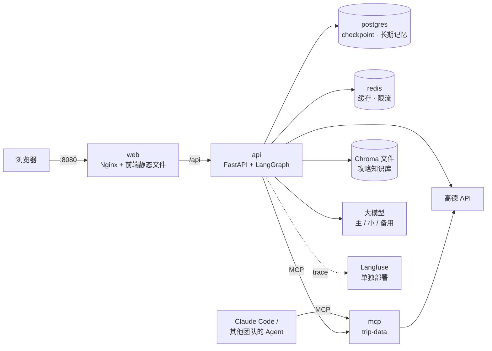

# P13：部署与毕业项目

> **需求卡片**
> 运维同学："把系统交给我们吧。要求：新同事 clone 下来，**一条命令**能起全套环境；生产环境不依赖任何人的电脑；密钥不进代码、不进镜像；服务挂了能被自动发现。"
> 本迭代：**Docker Compose 一键部署 + 健康检查 + CI**，然后完成毕业项目。

**目标**：把 12 节课做出来的东西变成一个"可交付"的系统。学完你会掌握：多阶段 Docker 镜像、Compose 编排五个服务、存活检查和就绪检查的区别、容器间通信的坑、多进程部署时哪些状态会出问题、CI 里跑测试和评测。最后用毕业项目把整门课串起来。

> 本课代码在临时目录里测试过：新增 3 个测试，共 106 个全部通过（`/ready` 正常和数据库故障两种情况、`docker-compose.yml` 的结构）。**特别验证了一个部署时才会出现的坑**：MCP Server 默认只接受 Host 为 localhost 的请求，放进 Docker 后主服务用 `http://mcp:7002` 访问会被拒绝（`421 Misdirected Request`），已经修复并验证（Step 2）。**本机没有 Docker，所以 Dockerfile、Compose、Nginx 配置没有实际构建和运行过**，CI 配置也没有在 GitHub 上跑过。第一次 `docker compose up` 时遇到问题，把报错发给我。

## 最终架构



## 本课新增 / 修改的文件

```
docker-compose.yml             ← 新增（项目根目录）
.github/workflows/ci.yml       ← 新增（项目根目录）
backend/
├── Dockerfile                 ← 新增
├── .dockerignore              ← 新增
├── .env.example               ← 重写：汇总所有配置
├── mcp_server/server.py       ← 修改：监听地址、允许的 Host 可配置
├── app/api/main.py            ← 修改：/ready 就绪检查
├── app/config.py              ← 修改：mcp_host、mcp_allowed_hosts
└── tests/test_deploy.py       ← 新增
frontend/
├── Dockerfile                 ← 新增
└── nginx.conf                 ← 新增
```

```bash
cd backend
uv add langgraph-checkpoint-postgres "psycopg[binary,pool]"   # 生产用 Postgres 存 checkpoint 和长期记忆
```

`P5` 的 `open_checkpointer` 和 `P7` 的 `open_store` 早就写好了 Postgres 分支，现在装上包就能用，代码不用改。这就是"配置驱动"的好处：开发用 SQLite，生产用 Postgres，只改一个环境变量。

## Step 1：存活检查与就绪检查 `app/api/main.py`

把原来的 `/health` 下面加上 `/ready`（导入 `from app.services.cache import RedisCache, get_cache`）：

```python
@app.get("/health")
def health():
    """存活检查（liveness）：只要进程活着就返回 healthy。容器编排系统据此判断要不要重启这个容器"""
    return {"status": "healthy"}


@app.get("/ready")
async def ready():
    """就绪检查（readiness，P13）：依赖的数据库、Redis 都能用，才算"可以接流量"

    和 /health 的区别：数据库暂时连不上时，进程本身没问题，不应该被重启（重启也没用），
    但应该暂时不要把用户请求分给它。负载均衡器 / Kubernetes 会根据这个接口决定是否转发流量
    """
    checks: dict[str, str] = {}

    async def check(name: str, probe) -> None:
        try:
            await probe()
            checks[name] = "ok"
        except Exception as exc:
            checks[name] = f"error: {type(exc).__name__}"

    await check("checkpointer", lambda: app.state.trip_graph.checkpointer.aget_tuple({"configurable": {"thread_id": "__ready__"}}))
    await check("store", lambda: app.state.store.asearch(("__ready__",), limit=1))
    cache = get_cache()
    if isinstance(cache, RedisCache):
        await check("redis", cache.redis.ping)
    ok = all(v == "ok" for v in checks.values())
    return JSONResponse(status_code=200 if ok else 503, content={"ready": ok, "checks": checks})
```

| | 存活检查 `/health` | 就绪检查 `/ready` |
|---|---|---|
| 回答的问题 | 进程还活着吗？ | 现在能处理请求吗？ |
| 失败了怎么办 | 重启容器 | 暂停分配流量，等它恢复 |
| 检查什么 | 什么都不查，能返回就行 | 数据库、Redis 等依赖 |
| 常见错误 | 在存活检查里查数据库：数据库一抖动，所有实例被同时重启，雪上加霜 | |

## Step 2：MCP Server 在容器里的两个坑 `mcp_server/server.py`

**坑 1：监听地址**。P8 写死了 `host="127.0.0.1"`：只接受本机的连接。在容器里，"本机"就是这个容器自己，其他容器（api）连不进来。改成从配置读，容器里设成 `0.0.0.0`。

**坑 2：Host 请求头**。我在临时目录里模拟了"api 容器用 `http://mcp:7002` 访问"，结果：

```
WARNING  Invalid Host header: mcp:7002
"HTTP/1.1 421 Misdirected Request"
```

FastMCP 默认开启了 **DNS 重绑定防护**，只接受 Host 是 `127.0.0.1` / `localhost` 的请求。这个防护防的是：你在本机开着一个 MCP 服务，访问了一个恶意网页，网页里的 JS 通过 DNS 重绑定把请求发到你本机的 MCP 服务上。**不要直接关掉它**，而是把允许的 Host 做成配置。

`app/config.py` 的 MCP 配置改成：

```python
    mcp_host: str = "127.0.0.1"  # P13：MCP Server 监听的地址。容器里要改成 0.0.0.0，否则其他容器连不上
    mcp_port: int = 7002  # MCP Server 监听的端口
    # P13：允许的 Host 请求头（防 DNS 重绑定攻击）。Docker Compose 里主服务用 http://mcp:7002 访问，要加上 mcp:*
    mcp_allowed_hosts: str = "127.0.0.1:*,localhost:*"
```

`mcp_server/server.py`：导入 `from mcp.server.transport_security import TransportSecuritySettings`，创建 `FastMCP` 时加上：

```python
# P13：DNS 重绑定防护。FastMCP 默认只接受 Host 是 127.0.0.1 / localhost 的请求
# 放进 Docker 后，主服务通过 http://mcp:7002 访问，Host 是 "mcp:7002"，会被拒绝（421 Misdirected Request）
# 所以把允许的 Host 做成配置。不要直接关掉防护：它防的是"恶意网页通过浏览器访问你本机的 MCP 服务"
ALLOWED_HOSTS = [h.strip() for h in get_settings().mcp_allowed_hosts.split(",") if h.strip()]

mcp = FastMCP(
    "trip-data",
    transport_security=TransportSecuritySettings(
        enable_dns_rebinding_protection=True,
        allowed_hosts=ALLOWED_HOSTS,
        allowed_origins=[f"http://{h}" for h in ALLOWED_HOSTS],
    ),
    ...
)
```

最后一行改成 `uvicorn.run(build_app(settings.mcp_token), host=settings.mcp_host, port=settings.mcp_port)`。

修改后验证：Host 为 `127.0.0.1:7994`、`mcp:7002` 都返回 200，`evil.com` 依然返回 421。

> **"在我电脑上是好的"**：这类问题只有换了运行环境才会暴露。所以公司里会有一个和生产环境尽量一致的"预发环境"，代码先在那里跑一遍。本课的 Compose 就是你的预发环境。

## Step 3：后端镜像 `backend/Dockerfile`

```dockerfile
# 后端镜像（P13）：api 和 mcp 两个服务共用这一个镜像，启动命令不同

FROM python:3.13-slim

# 从 uv 官方镜像里复制 uv 的可执行文件，版本和本机开发用的保持一致
COPY --from=ghcr.io/astral-sh/uv:0.12.13 /uv /uvx /bin/

WORKDIR /app
# UV_COMPILE_BYTECODE：安装时预编译 .pyc，容器启动更快
# UV_LINK_MODE=copy：容器里不能用硬链接（缓存和项目不在一个文件系统上），直接复制
ENV UV_COMPILE_BYTECODE=1 UV_LINK_MODE=copy

# 先只复制依赖清单并安装依赖。Docker 按层缓存：只要 pyproject.toml / uv.lock 没变，
# 这一层就直接复用，改业务代码后重新构建只需要几秒（前端类比：先 COPY package.json 再 npm ci）
COPY pyproject.toml uv.lock ./
RUN uv sync --frozen --no-dev --no-install-project

# 再复制代码
COPY . .
RUN uv sync --frozen --no-dev

# 让 python、uvicorn 直接用虚拟环境里的版本
ENV PATH="/app/.venv/bin:$PATH"

# 不用 root 运行：容器被攻破时，攻击者拿到的权限越小越好
RUN useradd --create-home appuser && mkdir -p /app/data && chown -R appuser /app/data
USER appuser

EXPOSE 7001
# 不要用 run.py：它开了 reload=True，只适合开发
# --timeout-graceful-shutdown：收到停止信号后，最多等 30 秒让正在处理的请求完成，再退出
CMD ["uvicorn", "app.api.main:app", "--host", "0.0.0.0", "--port", "7001", "--timeout-graceful-shutdown", "30"]
```

`backend/.dockerignore`：

```text
# 不复制进镜像的文件（和 .gitignore 类似）。.env 绝对不能进镜像：镜像会被推到仓库，里面的密钥就泄露了
.venv
.env
data
__pycache__
.pytest_cache
evals/results
```

**要点**

1. **先装依赖、再复制代码**：Docker 一层一层地缓存，`COPY pyproject.toml uv.lock` 这一层不变，后面的 `uv sync` 就直接用缓存。改了业务代码，重新构建只需要几秒。前端里 `COPY package.json` → `npm ci` → `COPY .` 是同样的道理。
2. **`.env` 绝不能进镜像**：镜像会被推到镜像仓库，所有能拉取镜像的人都能看到里面的文件。密钥在运行时通过环境变量注入（Compose 的 `env_file`，生产环境用云厂商的密钥管理服务）。
3. **不用 root 运行**：容器隔离不是绝对的，进程权限越小，被攻破时的损失越小。

## Step 4：前端镜像 `frontend/Dockerfile`、`frontend/nginx.conf`

```dockerfile
# 前端镜像（P13）：先用 Node 构建，再把构建结果交给 Nginx 提供静态文件（多阶段构建）

# ---------- 第一阶段：构建 ----------
FROM node:22-alpine AS build
WORKDIR /app
COPY package.json package-lock.json ./
RUN npm ci
COPY . .
# VITE_ 开头的变量在构建时就被写进 JS 文件里了，所以要在构建阶段传入（docker compose 的 build.args）
# 注意：这些值最终会出现在浏览器里，任何人都能看到，只能放前端本来就公开的 Key
ARG VITE_AMAP_JS_KEY=""
ARG VITE_AMAP_SECURITY_CODE=""
ENV VITE_API_BASE_URL=""
RUN npm run build

# ---------- 第二阶段：运行 ----------
# 最终镜像里只有 Nginx 和构建好的静态文件，没有 node_modules、没有源码，体积小得多
FROM nginx:1.27-alpine
COPY --from=build /app/dist /usr/share/nginx/html
COPY nginx.conf /etc/nginx/conf.d/default.conf
EXPOSE 80
```

```nginx
# 前端 Nginx 配置（P13）：提供静态文件，并把 /api 转发给后端（同源，不需要 CORS）

server {
    listen 80;

    root /usr/share/nginx/html;

    # 单页应用：刷新 /result/xxx 这样的前端路由时，Nginx 找不到对应的文件，统一返回 index.html
    location / {
        try_files $uri $uri/ /index.html;
    }

    location /api/ {
        proxy_pass http://api:7001;  # "api" 是 docker-compose 里后端服务的名字
        proxy_set_header Host $host;
        proxy_set_header X-Request-ID $request_id;  # P2：Nginx 生成的请求 ID 传给后端，日志能串起来

        # SSE（P4）必须的设置：
        proxy_http_version 1.1;          # 长连接
        proxy_set_header Connection "";
        proxy_buffering off;             # 不缓冲：事件到了就立刻转发给浏览器，否则进度会攒到最后一起出现
        proxy_read_timeout 300s;         # 默认 60 秒没数据就断开；我们有 15 秒的心跳，这里再放宽一些
    }
}
```

**SSE 走 Nginx 的四个配置**：`proxy_http_version 1.1`、清空 `Connection` 头、`proxy_buffering off`、加大 `proxy_read_timeout`。缺任何一个，P4 的逐天草稿要么全部攒到最后才出现，要么一分钟后连接被断开。后端响应头里的 `X-Accel-Buffering: no`（第 11 课）也能关闭缓冲，两边都设置更保险。

**同源部署**：前端和 `/api` 都由 Nginx 在同一个域名下提供，浏览器眼里没有跨域，第 2 课的 CORS 配置在生产环境里用不上了（开发环境的 Vite 代理是同样的思路）。

## Step 5：编排 `docker-compose.yml`（项目根目录）

```yaml
# 一条命令启动全套服务（P13）：docker compose up -d --build
#
#   浏览器 → web(Nginx :8080) ─/api→ api(FastAPI :7001) ──→ postgres（会话 checkpoint、长期记忆）
#                                        │                ──→ redis（缓存、限流）
#                                        └─ MCP ─────────→ mcp(trip-data :7002)
#   Langfuse 体量较大（自带 Postgres、ClickHouse、Redis、MinIO），按 P2 的方式单独部署

services:
  postgres:
    # pgvector 镜像 = 官方 Postgres + 向量扩展，长期记忆的语义检索要用（P7）
    image: pgvector/pgvector:pg17
    environment:
      POSTGRES_USER: trip
      POSTGRES_PASSWORD: ${POSTGRES_PASSWORD:-trip-dev-password}  # 从环境变量读，没有就用默认值（只能用于本地）
      POSTGRES_DB: trip
    volumes:
      - pgdata:/var/lib/postgresql/data  # 数据存在命名卷里，容器删了数据还在
    healthcheck:
      test: ["CMD-SHELL", "pg_isready -U trip"]
      interval: 5s
      retries: 10

  redis:
    image: redis:7-alpine
    healthcheck:
      test: ["CMD", "redis-cli", "ping"]
      interval: 5s
      retries: 10

  mcp:
    build: ./backend
    command: ["python", "-m", "mcp_server.server"]
    env_file: ./backend/.env  # 高德 Key、MCP_TOKEN 等，和本地开发用同一个文件
    environment:
      MCP_HOST: 0.0.0.0  # 容器里必须监听所有网卡，其他容器才能访问
      MCP_ALLOWED_HOSTS: "mcp:*,localhost:*,127.0.0.1:*"  # P13：允许 api 用 http://mcp:7002 访问
      REDIS_URL: redis://redis:6379/1  # 高德缓存。用 1 号库，和 api 的限流计数分开
    depends_on:
      redis:
        condition: service_healthy

  api:
    build: ./backend
    env_file: ./backend/.env
    environment:
      # 覆盖 .env 里的本地开发配置：容器之间用服务名互相访问
      CHECKPOINT_URL: postgresql://trip:${POSTGRES_PASSWORD:-trip-dev-password}@postgres:5432/trip
      STORE_URL: postgresql://trip:${POSTGRES_PASSWORD:-trip-dev-password}@postgres:5432/trip
      REDIS_URL: redis://redis:6379/0
      TRIP_MCP_URL: http://mcp:7002/mcp
      APP_ENV: prod
      # Langfuse 在宿主机上运行时，容器里用 host.docker.internal 访问宿主机
      LANGFUSE_BASE_URL: ${LANGFUSE_BASE_URL:-http://host.docker.internal:3000}
    volumes:
      - apidata:/app/data  # 知识库（Chroma）的数据
    depends_on:
      postgres:
        condition: service_healthy  # 等 Postgres 真正可以连接了再启动，而不只是容器启动了
      redis:
        condition: service_healthy
      mcp:
        condition: service_started
    healthcheck:
      # slim 镜像里没有 curl，用 Python 自带的 urllib
      test: ["CMD", "python", "-c", "import urllib.request; urllib.request.urlopen('http://127.0.0.1:7001/ready')"]
      interval: 10s
      retries: 6
      start_period: 20s

  web:
    build:
      context: ./frontend
      args:
        VITE_AMAP_JS_KEY: ${VITE_AMAP_JS_KEY:-}
        VITE_AMAP_SECURITY_CODE: ${VITE_AMAP_SECURITY_CODE:-}
    ports:
      - "8080:80"  # 只有前端暴露给宿主机；api、mcp、数据库都只在容器网络内部可见
    depends_on:
      api:
        condition: service_healthy

volumes:
  pgdata:
  apidata:
```

**要点**

1. **服务名就是主机名**：容器之间用 `postgres`、`redis`、`mcp`、`api` 互相访问，Compose 自动提供 DNS。
2. **`depends_on` + `condition: service_healthy`**：只写 `depends_on: [postgres]` 只保证 Postgres 容器**启动了**，不保证它**能连接了**（Postgres 启动要几秒），api 会在启动时连不上数据库而崩溃。
3. **只有 web 暴露端口**：api、mcp、数据库都只在容器网络内部可见。对外的入口越少越安全。
4. **数据放在命名卷里**：`pgdata`、`apidata`。`docker compose down` 不会删除卷，`docker compose down -v` 才会，**这个 `-v` 要慎用**。
5. **环境变量的优先级**：`environment` 里写的会覆盖 `env_file` 里的。所以 `.env` 可以和本地开发共用一份，容器里需要不同的值（数据库地址）在 `environment` 里覆盖。

## Step 6：跑起来

```bash
# 项目根目录
cp backend/.env.example backend/.env    # 第一次：填好高德、大模型的 Key
docker compose up -d --build            # 构建并后台启动
docker compose ps                       # 所有服务都是 running / healthy
docker compose logs -f api              # 看后端日志（带着 P2 的 request_id）

# 知识库入库（一次性任务）：在 api 容器里执行 P9 的入库命令
docker compose exec api python -m app.knowledge.ingest

# 打开 http://localhost:8080
```

验证清单：

- [ ] 生成一个行程，逐天草稿正常出现（Nginx 没有缓冲 SSE）
- [ ] `docker compose restart api`，刷新结果页，会话还在（checkpoint 在 Postgres 里）
- [ ] 对话里问"故宫要预约吗"，有引用（知识库可用）
- [ ] 对话里说"晚上想吃烤鸭"，能搜到新餐厅（api → mcp 的连接正常）
- [ ] `docker compose stop postgres`，等半分钟，`docker compose ps` 里 api 变成 unhealthy（就绪检查生效）；`docker compose start postgres` 后恢复成 healthy

## Step 7：多进程部署的注意事项

到目前为止，api 容器里只有 **1 个 uvicorn 进程**。想用多核或者部署多个实例，下面这些"存在进程内存里的状态"就会出问题：

| 状态 | 在哪 | 多进程时的问题 | 怎么办 |
|---|---|---|---|
| 后台任务的事件日志（P12） | `JobManager` | 任务在 A 进程跑，重连被分到 B 进程，找不到任务 | 事件日志放 Redis Streams（作业 2），或者负载均衡按 job_id 做会话保持 |
| 高德限速（第 9 课） | `AmapClient` | 每个进程各自限速，总 QPS 翻倍 | 限速计数放 Redis（和 P12 的用户限流同一个思路） |
| 缓存、用户限流（P12） | `REDIS_URL` 为空时在内存里 | 各进程各算各的 | Compose 里已经配置了 Redis ✅ |
| 会话、长期记忆（P5、P7） | SQLite 文件 | 多个实例写同一个文件会冲突 | Compose 里已经用 Postgres ✅ |
| 知识库（P9） | Chroma 文件 | 多个实例共享一个目录可以读，但同时写入会冲突 | 入库只在一个地方执行；规模大了换 Chroma 服务端模式或 pgvector |
| MCP 工具列表缓存（P8） | 模块变量 | 每个进程缓存一份，问题不大 | — |

**这张表是本课最值得记住的东西**：单机能跑的代码，扩展到多实例时，第一件事就是找出所有"进程内的状态"。

## Step 8：持续集成 `.github/workflows/ci.yml`（项目根目录）

```yaml
# 持续集成（P13）：每次提交跑测试；改了 prompt 的 PR 额外跑一个小规模评测（P3）

name: ci

on:
  push:
    branches: [main]
  pull_request:

jobs:
  test:
    runs-on: ubuntu-latest
    defaults:
      run:
        working-directory: backend
    steps:
      - uses: actions/checkout@v4
      - uses: astral-sh/setup-uv@v6
      - run: uv sync --frozen
      - run: uv run pytest -q

  eval-smoke:
    # 只在 PR 改了 prompt、图或评测本身的时候跑：评测要调用真实模型，花钱、花时间
    if: github.event_name == 'pull_request'
    needs: test
    runs-on: ubuntu-latest
    defaults:
      run:
        working-directory: backend
    steps:
      - uses: actions/checkout@v4
      - uses: dorny/paths-filter@v3
        id: changes
        with:
          filters: |
            llm:
              - 'backend/app/agents/prompts.py'
              - 'backend/app/graph/**'
              - 'backend/evals/**'
      - if: steps.changes.outputs.llm == 'true'
        uses: astral-sh/setup-uv@v6
      - if: steps.changes.outputs.llm == 'true'
        run: uv sync --frozen
      - if: steps.changes.outputs.llm == 'true'
        # 密钥放在仓库的 Settings → Secrets 里，不写进代码
        env:
          LLM_API_KEY: ${{ secrets.LLM_API_KEY }}
          LLM_BASE_URL: ${{ secrets.LLM_BASE_URL }}
          LLM_MODEL_ID: ${{ secrets.LLM_MODEL_ID }}
        # 成功率低于 80% 时退出码为 1，PR 会被标红，不能合并
        run: uv run python -m evals.run --variant ci --tags 常规 --limit 5 --min-success 0.8
```

两个任务：每次提交都跑 `pytest`（不花钱、一分钟以内）；PR 改了 prompt、图、评测代码时，再用真实模型跑 5 条用例的冒烟评测，成功率低于 80% 就不让合并。这就是 P3 说的"先有尺子再改代码"在团队协作里的落地方式。

## Step 9：测试 `tests/test_deploy.py`

```python
"""P13：部署相关"""

from pathlib import Path

import yaml

from app.api.main import app


def test_ready(client):
    body = client.get("/ready").json()
    assert body == {"ready": True, "checks": {"checkpointer": "ok", "store": "ok"}}


class BrokenStore:
    """替身：一个连不上数据库的 store"""

    async def asearch(self, *args, **kwargs):
        raise ConnectionError("db down")


def test_not_ready_when_store_is_down(client, monkeypatch):
    monkeypatch.setattr(app.state, "store", BrokenStore())
    response = client.get("/ready")
    assert response.status_code == 503
    assert response.json()["checks"]["store"] == "error: ConnectionError"
    assert client.get("/health").status_code == 200  # 存活检查不受影响：进程本身没问题，不需要重启


def test_compose_file_is_valid():
    """docker-compose.yml 至少要是合法的 YAML，服务之间的依赖关系要对"""
    compose = yaml.safe_load((Path(__file__).resolve().parents[2] / "docker-compose.yml").read_text(encoding="utf-8"))
    services = compose["services"]
    assert set(services) == {"postgres", "redis", "mcp", "api", "web"}
    assert services["api"]["depends_on"]["postgres"]["condition"] == "service_healthy"
    assert "mcp:*" in services["mcp"]["environment"]["MCP_ALLOWED_HOSTS"]
```

```bash
uv run pytest -q
# 106 passed
```

## 了解：LangGraph Agent Server 与 Studio

本课程自己用 FastAPI 包装了 LangGraph。LangChain 官方还提供了一个现成的服务端：**LangGraph Agent Server**（以前叫 LangGraph Platform / LangGraph Server），在 `langgraph.json` 里声明图的位置，`langgraph dev` 就能在本地启动，自带：

| 功能 | 本课程里对应的是 |
|---|---|
| threads / runs 的 REST API | P5 的会话接口 |
| 后台运行、断线重连 | P12 的 JobManager |
| 中断与恢复 | P6 的 resume 接口 |
| 长期记忆 Store | P7 |
| 定时任务（cron） | 无 |
| **LangGraph Studio**：可视化调试图，单步执行、查看和修改每一步的 state | 无（我们靠 Langfuse + 测试） |

**为什么本课程没用它？** 一是为了让你亲手实现这些机制，理解它们是怎么工作的；二是我们的图依赖运行时注入的对象（高德客户端、模型、知识库），Agent Server 的运行时上下文只能是 JSON 数据，需要额外改造（比如在节点里按配置自己创建客户端）。公司里两种做法都很常见：小团队直接用 Agent Server 省事；已有完整后端体系的团队，像本课程这样把 LangGraph 当成一个库嵌进去。作业 3 让你动手试一下。

---

# 🎓 毕业项目

## 交付物

在 `doc/进阶/毕业项目/` 下完成：

1. **架构说明**：用你自己的话（和图）讲清楚：一次"生成行程"请求从浏览器到返回，经过了哪些组件、每个组件做了什么；一次"修改行程"呢？中断和恢复呢？
2. **三份 ADR**：
   - ADR-001：修改助手采用单 Agent 还是多 Agent（P10 作业，用评测数据）
   - ADR-002：为什么规划流程用 LangGraph 工作流，而不是让 Agent 自主调用工具（第 8 课 → 第 9 课 → P1）
   - ADR-003：长期记忆的设计（记什么、怎么更新、怎么保护隐私）
3. **评测报告**：基础课版本（第 9 课的 `ContextTripPlanner`）vs 进阶课最终版本，在 P3 评测集上的全部指标、成本、延迟；修改助手在 P10 对话评测集上的结果；安全评测集（P11 作业）的结果。
4. **5 分钟演示**（录屏或现场）：
   1. 生成一个带一岁宝宝、预算 3000 元的北京 3 天行程：逐天草稿出现 → 预算超出，弹出确认 → 选"降档"
   2. 对话："第一天晚上想吃烤鸭" → 搜索新餐厅、替换、预算更新
   3. 对话："故宫周一开门吗" → 带引用的回答
   4. 对话："帮我订酒店" → 审批弹窗 → 刷新页面，弹窗还在 → 批准
   5. 新开一个会话生成别的城市的行程，不说任何偏好 → 生成结果考虑了"带宝宝"（长期记忆）
   6. 打开 Langfuse，找到第 2 步的 trace，讲解每一步
   7. `docker compose restart api` → 会话还在

## 掌握程度自查

对照 `00-进阶学习计划.md` 的"最终掌握标准"，下面每个问题都能不看资料讲清楚，就毕业了：

| 课 | 面试高频问题 |
|---|---|
| P1 | LangGraph 相比函数调用链解决了什么问题？State 什么时候需要 reducer？条件边和 `Command` 有什么区别？ |
| P2 | Agent 系统为什么特别依赖 tracing？trace、span、generation 是什么关系？你会监控哪些指标？ |
| P3 | 怎么评估一个 Agent 的好坏？为什么要冻结输入？LLM-as-judge 有哪些偏差，怎么缓解？ |
| P4 | 同步和异步接口在 FastAPI 里分别跑在哪？为什么不把 JSON token 直接推给前端？客户端断开后怎么停止生成？ |
| P5 | 短期记忆和长期记忆的区别？checkpointer 存的是什么？撤销是怎么实现的？工具怎么修改 Agent 的 state？ |
| P6 | 哪些操作需要人工确认？interrupt 恢复时节点从哪里开始执行？怎么保证"确认"只生效一次？ |
| P7 | 长期记忆有哪些正确性和隐私风险？为什么抽取的输出是"增删改操作"而不是"记忆列表"？ |
| P8 | Function Calling 和 MCP 是什么关系？一个好的工具描述长什么样？工具出错时，什么错误该重试、什么错误该交给模型？ |
| P9 | RAG 效果不好从哪几个环节排查？为什么要混合检索？RRF 怎么融合？什么时候用 Agentic RAG？ |
| P10 | 三种多 Agent 模式各适合什么场景？多 Agent 的成本在哪？你怎么决定拆不拆？ |
| P11 | 怎么防 prompt 注入？为什么说只能纵深防御？间接注入有哪些入口？PII 要在哪几处脱敏？ |
| P12 | Agent 的成本优化有哪些手段？多层重试有什么风险？什么是持久执行？ |
| P13 | 存活检查和就绪检查的区别？单机服务扩展到多实例时要注意什么？ |

## 📝 课后作业

- [ ] 1. **跑起来**：本机安装 Docker Desktop，完成 Step 6 的全部验证清单。遇到的每个问题和解决方法记在笔记里，这就是你的"部署手册"。
- [ ] 2. **事件日志放进 Redis**：把 P12 的 `JobManager` 改成用 Redis Streams 存事件（`XADD` 写入，`XREAD BLOCK` 订阅），然后把 api 的 uvicorn 改成 `--workers 2`，验证断线重连被分到另一个进程时依然能续上。
- [ ] 3. **体验 Agent Server**：`uv add --dev "langgraph-cli[inmem]"`，写一个 `langgraph.json` 指向一个不依赖外部对象的小图（比如 P1 的 collect 子图，在节点里自己调用 `get_amap_client()`），运行 `langgraph dev`，用 Studio 单步调试。对比一下它和你自己用 FastAPI 包装的方式。
- [ ] 4. **毕业项目**：完成上面的四项交付物。

## 我的笔记

<!-- 在这里记录部署过程中遇到的问题，以及毕业项目的心得 -->
